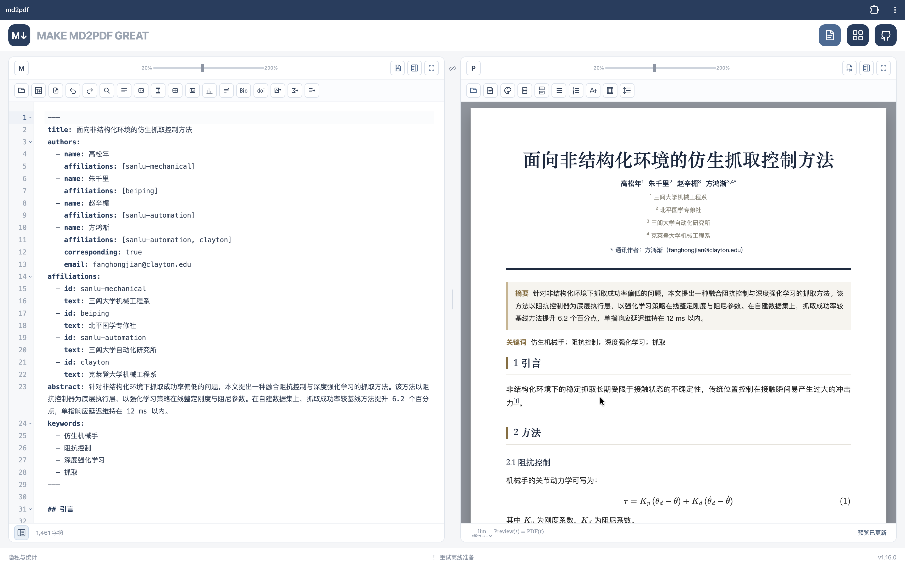
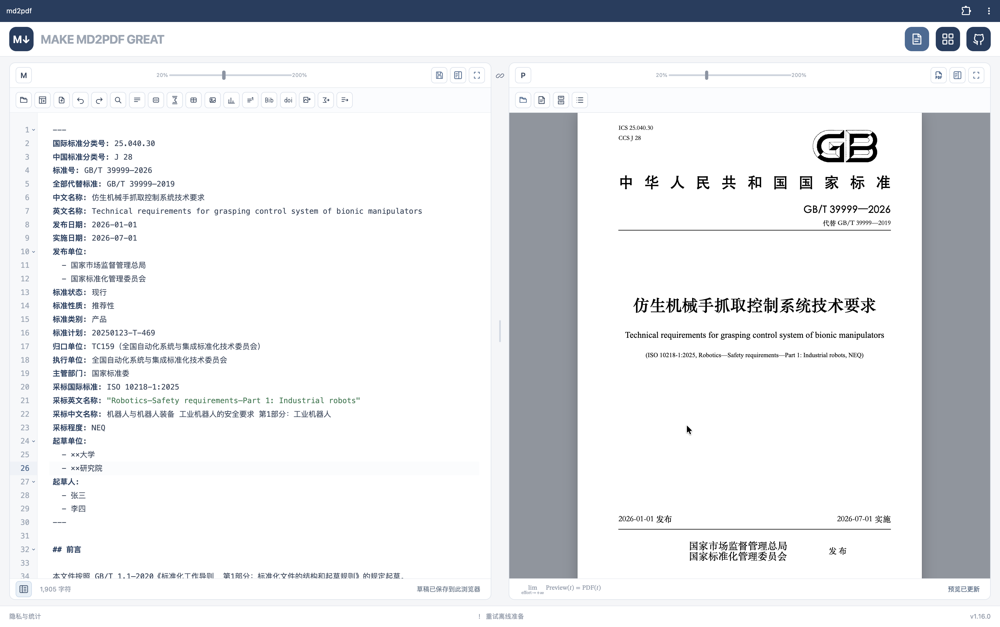
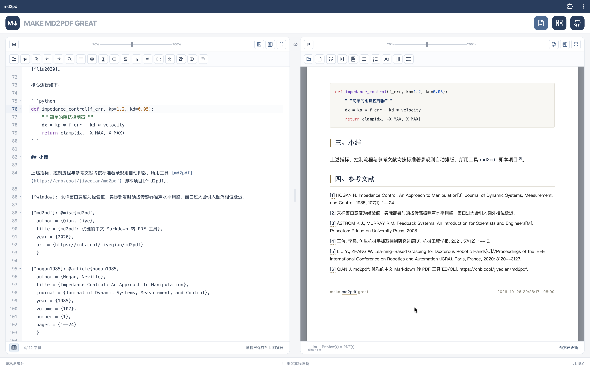

# md2pdf

<p align="center">
  
</p>

<p align="center"><strong>Markdown 驱动的专业 PDF 排版工具</strong></p>

<p align="center">
  <a href="https://www.npmjs.com/package/@jiyeqian/md2pdf"></a>
  <a href="https://github.com/jiyeqian/md2pdf/blob/main/LICENSE"></a>
  <a href="https://cnb.cool/jiyeqian/md2pdf/-/build"></a>
</p>

md2pdf 将 Markdown 转为适合阅读、打印和分享的 PDF，支持 CLI、在线工作台和静态网页三种使用方式。

## 选择适合你的版本

| 版本 | 适合场景 | 文档与隐私 | PDF 导出 |
| --- | --- | --- | --- |
| **CLI** | 本地批量转换、脚本或自动化流程 | 在自己的电脑上运行 | 本机生成 PDF |
| **服务器版** | 无需安装，打开网页即可编辑 | 排版请求发送到服务端；服务不保存文档 | 服务端生成并下载 PDF；[在线试用](https://md2pdf.app.workbuddy.host/) |
| **静态版** | 希望在浏览器本地编辑和排版 | 文档留在浏览器本地，可离线继续使用 | 调用浏览器打印并保存 PDF；[在线试用](https://md2pdf.qianjiye.de/) |

WebApp 只记录软件使用情况，不上传用户文档；可选统计可在页面底部的“隐私与统计”中管理。详见[完整隐私说明](https://md2pdf.qianjiye.de/privacy.html)。

## 特色功能

- **论文排版**：整理作者与单位、摘要和关键词，支持 LaTeX 公式、图表编号、交叉引用及参考文献。
- **国家标准排版**：生成标准封面、页眉、章条编号、目次和附录版式。
- **LaTeX 风格参考文献**：支持 BibTeX 与 DOI 元数据插入，按正文引用顺序编排，生成 GB/T 7714—2025 格式并提供正文与文末双向跳转。
- **多种文档模板**：通用文档、技能文档、学术论文和国家标准，可从模板或完整示例开始。
- **边写边看**：编辑 Markdown 时查看分页预览，公式、Mermaid 图表、表格和代码块均可参与排版。
- **多设备工作台**：支持桌面与窄屏布局；草稿保存在当前浏览器，可下载 Markdown 备份。

## 看看排版效果

**支持论文排版**



**支持国标排版**



**支持 LaTeX 参考文献**



## 开始使用

安装 CLI（需要 Node.js 18 或更高版本，以及 Chrome、Edge 或 Chromium）：

```bash
npm install -g @jiyeqian/md2pdf
md2pdf 你的文档.md --open
```

启动本地 Web 工作台：

```bash
md2pdf webapp
```

然后打开 `http://127.0.0.1:3000`。也可直接体验上方的服务器版或静态版。

## 继续了解

- [CLI 使用与参数](docs/cli.md)
- [WebApp 使用说明](docs/webapp.md)
- [静态版部署说明](docs/static-webapp.md)
- [国家标准模板说明](docs/gb-template.md)
- [模板与示例库](examples/README.md)
- [开发与发布说明](docs/development.md)
