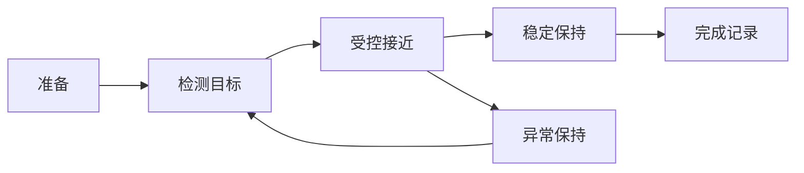

<!-- gb-check: 全面范例；假设标准，技术数据仅用于版式演示；GB/T 1.1—2020 9.7/9.8/9.9、10及附录E/F -->

## 前言

本文件按照 GB/T 1.1—2020《标准化工作导则　第1部分：标准化文件的结构和起草规则》的规定起草。

本文件为排版能力演示用假设标准，文件编号、技术指标和试验记录不作为实际产品的合格判定依据。

本文件代替 GB/T 142857—2019《仿生机械手抓取控制系统技术要求》，与 GB/T 142857—2019 相比，除结构调整和编辑性改动外，主要技术变化如下：

- 增加了多环境下的稳定抓取要求和异常恢复要求；
- 增加了分项检测条件、控制误差的计算方法和连续试验记录；
- 完善了试验步骤、试验报告和数据追溯要求。

请注意本文件的某些内容可能涉及专利。本文件的发布机构不承担识别专利的责任。

本文件由中华人民共和国工业和信息化部提出。

本文件由全国自动化系统与集成标准化技术委员会（SAC/TC 159）归口。

本文件起草单位：××大学、××研究院。

本文件主要起草人：张三、李四。

本文件中的试验数据仅用于验证排版能力[^@purpose]。

[^@purpose]: 本文件为假设标准，不作为真实产品的合格判定依据。

## 引言

仿生机械手在非结构化环境中的稳定抓取，需要同时考虑接触力、关节位姿、目标物表面状态和故障恢复过程。对试验条件、量的符号和结果记录作出一致规定，有助于比较不同控制方案。

本文件将一般技术要求、检测方法和判定规则结合编排，图、表和数学公式分别表达控制流程、试验数据以及量之间的关系。有关结构和表述形式的依据见参考文献[^gb11]，有关仿真测试与术语组织的参考见参考文献[^gb48316]和参考文献[^gb21922]。

## 范围 {#sec:scope}

本文件规定了仿生机械手抓取控制系统的技术要求、试验方法、检验规则以及标志和使用说明，描述了相应的结果记录方法。

本文件适用于工业、物流与服务机器人领域的仿生机械手抓取控制系统，不适用于直接作用于人体的医疗操作装置。

## 规范性引用文件 {#sec:normative-references}

下列文件中的内容通过文中的规范性引用而构成本文件必不可少的条款。其中，注日期的引用文件，仅该日期对应的版本适用于本文件；不注日期的引用文件，其最新版本（包括所有的修改单）适用于本文件。

GB/T 191　包装储运图示标志

GB/T 4208—2017　外壳防护等级（IP代码）

GB/T 12643—2013　机器人与机器人装备　词汇

GB/T 20000.1—2014　标准化工作指南　第1部分：标准化和相关活动的通用术语

## 术语和定义 {#sec:terms}

GB/T 12643—2013、GB/T 20000.1—2014 界定的以及下列术语和定义适用于本文件。为区分性能量与基础概念，术语按类别编排；各类别中的英文对应词、定义、来源及附注均属于相应术语条目。

<!-- gb-check: F.1/10.3.5；中英文术语五号黑体，间空一字，长定义及条目注 -->

### 控制与性能术语 {#sec:control-terms}

:::gb-term id=grasp
抓取成功率
grasping success rate

在规定试验条件下，成功抓取并保持目标物达到规定时间的次数与总抓取尝试次数之比。

:::gb-note label="注1："
成功抓取还包括在规定的保持阶段，目标物没有发生超出允许值的滑移、翻转或脱离。统计时应记录接近、接触、提升和保持各阶段的状态；当试验装置在阶段切换时产生短暂信号波动，应依据事先约定的判据区分测量噪声与实际失效，不应在结果出现后临时调整判定口径。
:::

:::gb-note label="注2："
不同目标物类别应分别统计，合并统计时应同时给出各类别的试验次数，以免由样本构成改变比较结果。
:::
:::

:::gb-term id=impedance
阻抗控制
impedance control

通过调节刚度与阻尼参数，使机械手与环境接触时表现出期望力位关系的控制方式。

:::

:::gb-term id=recovery
异常恢复时间
fault recovery time

从检测到可恢复异常的时刻起，到系统重新进入可接受正常指令的工作状态所经历的时间。
:::

### 基础概念 {#sec:basic-concepts}

:::gb-term id=standard
标准
standard

通过标准化活动，按照规定的程序经协商一致制定，为各种活动或其结果提供规则、指南或特性，供共同使用和重复使用的文件。

:::gb-note kind=source
[来源：GB/T 20000.1—2014，5.3]
:::
:::

## 符号和缩略语 {#sec:symbols}

下列符号和缩略语适用于本文件。

- $F$：输出接触力；
- $K_p$：刚度系数；
- $K_d$：阻尼系数；
- $x$：实测位移；
- $x_d$：期望位移；
- API：应用程序接口（application programming interface）；
- RMS：均方根（root mean square）。

## 技术要求 {#sec:requirements}

技术要求包括一般要求、安全状态、控制性能和检测条件。各项要求应结合规定的试验环境、量值溯源和记录方法进行验证；对于具有不同末端执行器或控制模式的系统，应在试验开始前明确适用条件，并使后续检验与报告采用相同的配置。

### 一般要求 {#sec:general-requirements}

机械手应在 −10 ℃～40 ℃ 的环境温度下正常工作，设计的试验配置应涵盖低温、常温和高温状态。目标物、传感器量程及控制参数应在试验开始前记录。

系统的正常工作条件包括下列内容：

- 供电电压和通信接口符合制造商给出的额定条件；
- 传感器完成校准，时间戳采用统一的时间基准，记录中保留采样周期及校准有效期；
- 工作空间内没有未经识别的障碍物，急停装置能够独立终止危险运动。

### 安全状态与异常恢复 {#sec:safety-recovery}

<!-- gb-check: 7.5、10.2.2；一层a)b)c)，二层1)2)，长列项回行和嵌套间隔号 -->

异常恢复应按下列顺序进行：

1. 识别异常并保持安全状态，记录触发时刻、目标物状态和控制器最近一次有效输出；当恢复过程中需要人工确认时，应清楚给出等待条件，避免自动执行未经确认的动作；
2. 检查恢复条件，包括：
   1. 传感器重新进入有效测量范围，并连续获得规定数量的有效样本；
   2. 通信接口的序列号和时间戳连续，缓存数据不会被误认为新测量值；
3. 恢复受控运动，满足下列条件：
   - 先以受限速度接近目标位姿，确认接触力没有超过允许值；
   - 再逐步恢复额定控制参数，并记录最终恢复时刻。

### 控制性能 {#sec:control-performance}

#### 抓取成功率 {#sec:grasp-success}

抓取成功率应不低于 98%。每组试验应完成不少于 100 次抓取，目标物的类型、质量和表面状态应保持可追溯。

#### 单指响应延迟 {#sec:finger-latency}

单指响应延迟应不大于 12 ms。期望力位关系按公式（1）确定。

<!-- gb-check: 9.9/10.4.3；变量斜体、编号右齐、省略点引导、长释义悬挂 -->

:::gb-equation
$$F = K_p\,(x_d-x) + K_d\,(\dot{x}_d-\dot{x}) \label{eq:force}$$

式中：
$F$ | 机械手输出作用力，单位为牛顿（N）；
$K_p$ | 刚度系数，表示位移误差产生的力响应；
$x_d$ | 期望位移，单位为米（m）；
$x$ | 实测位移，单位为米（m）；
$K_d$ | 阻尼系数，表示速度误差产生的力响应，其定义和取值范围应在不同环境试验中保持一致；当控制周期改变时，应重新核对相应参数；
$\dot{x}_d$ | 期望速度，单位为米每秒（m/s）；
$\dot{x}$ | 实测速度，单位为米每秒（m/s）。
:::

#### 综合误差 {#sec:overall-error}

综合误差按公式（2）计算。较长公式在加号之后回行，两行合为一个公式，不将其细分为带字母的子编号。

:::gb-equation
$$
\begin{aligned}
J ={}& \sum_{i=1}^{n} w_i\left(\frac{x_{d,i}-x_i}{s_x}\right)^2 + {}\\
&\lambda\sum_{i=1}^{n}\left(\frac{F_{d,i}-F_i}{s_F}\right)^2
\end{aligned}\label{eq:error}
$$

式中：
$J$ | 综合误差；
$n$ | 采样点总数；
$w_i$ | 第 $i$ 个采样点的权重；
$x_{d,i}$ | 第 $i$ 个采样点的期望位移；
$x_i$ | 第 $i$ 个采样点的实测位移；
$s_x$ | 位移归一化基准量；
$\lambda$ | 力误差权重；
$F_{d,i}$ | 第 $i$ 个采样点的期望接触力；
$F_i$ | 第 $i$ 个采样点的实测接触力；
$s_F$ | 接触力归一化基准量。
:::

### 性能指标与标定 {#sec:calibration}

系统性能应符合表 \ref{tab:perf} 的规定。数值相同量纲的比较应使用一致的单位，不在记录中省略有意义的有效数字。

表：抓取控制系统性能指标 {#tab:perf}

| 指标 | 要求 | 检测条件 |
| --- | --- | --- |
| 抓取成功率 | ≥ 98% | 每组 100 次 |
| 单指响应延迟 | ≤ 12 ms | 稳态运行 |
| 整机功耗 | ≤ 15 W | 额定负载 |

位移标定记录见表 \ref{tab:calibration}，同一数值列中的整数、小数和空单元格分别展示对齐及缺值表达。

:::gb-note scope=table kind=unit
单位为毫米
:::

表：位移标定记录 {#tab:calibration}

| 测点 | 设定值 | 实测值 |
| --- | --- | --- |
| 原点附近 | 9.2 | 9.1 |
| 中间位置 | 12.34 | 12.34 |
| 行程末端 | 123.45 | 123.40 |
| 未布置测点 | | |

:::gb-note scope=table label="注："
空白测点不构成有效的标定数据；一字线表示该测点没有对应记录。
:::

### 检测条件组合 {#sec:test-conditions}

<!-- gb-check: 9.8、10.4.2；多级表头、横纵合并、列宽、空格、整行表注和表脚注 -->

检测条件及判定要求见表 \ref{tab:complex}。各栏使用的单位不完全相同时，将单位列于相应的表头中。

表：分项检测条件与判定要求 {#tab:complex}

:::gb-table
widths: 24 37 28 28 48
head:
| {rowspan=2} 检测对象 | {rowspan=2} 检测项目 | {colspan=2} 环境条件 | {rowspan=2} 判定要求 |
| 温度/℃ | 相对湿度/% |
body:
| {rowspan=2} 控制器 | 稳态响应 | 25 ± 2 | 45～75 | 延迟不大于 12 ms |
| 异常恢复 | 25 ± 2 | 45～75 | 进入可接受指令的状态 |
| {rowspan=2} 末端执行器 | 保持能力 | 低温 −10 | 45～75 | 目标物无脱离 |
| 滑移检测 | 高温 40 | 45～75 | 在规定时间内识别滑移 |
| {colspan=2} 通信接口 | 25 ± 2 | | 记录序列号连续 |
:::

:::gb-note scope=table label="注1："
高低温条件仅用于区分不同检测状态，实际产品的环境适用范围应以产品文件为准。
:::

:::gb-note scope=table label="a）" label-weight=normal
传感器安装位置应在试验记录中说明，回行文字与本条脚注的内容起点对齐。
:::

### 数据有效性 {#sec:data-validity}

#### 时间序列的判定 {#sec:time-sequence}

##### 完整记录 {#sec:complete-records}

每组有效记录应包含连续时间戳、控制指令与反馈值。出现字段缺失时，应记录缺失区间和原因，避免只保留可通过判定的采样点。

##### 中断记录 {#sec:interrupted-records}

试验发生中断时应标识中断前后的状态，不应将两个不连续片段直接拼接为连续记录。

#### 异常数据的处理 {#sec:abnormal-data}

异常数据应保留原值及处理依据，处理前后的数据应能够相互追溯。

## 试验方法 {#sec:test-methods}

### 试验准备 {#sec:test-preparation}

试验前应确认量值溯源、试验装置连接和急停功能，采集装置的时钟应与控制器时钟同步[^@clock]。试验报告宜记录接口协议的英文名称，如 timestamp、sampling period 和 application programming interface，避免同一字段存在不同解释。

[^@clock]: 时间同步方法、估计误差和同步有效期应形成记录；采用外部时钟时还应记录时钟源及异常切换策略。对持续时间较长的试验，应定期检查时钟偏差，保证不同阶段的数据可比较。记录不应只保留结论，还应保留必要的过程证据与计算依据，以便复核。

记录中应保留采集装置时钟偏差与异常切换过程的追溯信息，以便复核时间同步结果。

### 控制流程 {#sec:control-flow}

控制流程见图 \ref{fig:flow}，数据处理的层次关系见图 \ref{fig:data}。图中的箭头分别表示状态转换或数据传递方向，流程图的图形表达可参阅参考文献[^gb1526]。

图：抓取与异常恢复流程 {#fig:flow}

:::gb-note scope=figure label="注："
异常保持状态不表示试验完成；未满足恢复条件时应继续保持安全状态。
:::

:::gb-note scope=figure label="a）" label-weight=normal
图示只表达状态转换关系，实际控制器还应记录各状态的进入与退出时刻。
:::

图：试验数据处理关系 {#fig:data}

:::gb-note scope=figure label="注1："
无效样本应保留标识，不应直接删除原始记录。
:::

:::gb-note scope=figure label="注2："
数据处理过程应能回溯到原始采样时间和设备编号。
:::

### 结果记录 {#sec:results}

试验结果宜按表 \ref{tab:records} 的顺序逐项记录。该表节选连续 40 条示意记录，用于核对跨页时的续表、表头、单位和表注；正式试验仍应满足每组不少于 100 次的要求。

<!-- gb-check: 9.8.3；40条记录逐条出现一次，续表重复表编号、表头、单位，表注在末段 -->

:::gb-note scope=table kind=unit
单位为毫秒
:::

表：连续抓取试验记录 {#tab:records}

| 记录编号 | 试验状态 | 响应时间 | 恢复时间 |
| --- | --- | --- | --- |
| R001 | 正常抓取 | 9.1 | — |
| R002 | 正常抓取 | 9.2 | — |
| R003 | 正常抓取 | 9.3 | — |
| R004 | 正常抓取 | 9.4 | — |
| R005 | 正常抓取 | 9.5 | — |
| R006 | 正常抓取 | 9.6 | — |
| R007 | 正常抓取 | 9.7 | — |
| R008 | 正常抓取 | 9.8 | — |
| R009 | 正常抓取 | 9.9 | — |
| R010 | 异常恢复 | 10.0 | 130 |
| R011 | 正常抓取 | 10.1 | — |
| R012 | 正常抓取 | 10.2 | — |
| R013 | 正常抓取 | 10.3 | — |
| R014 | 正常抓取 | 10.4 | — |
| R015 | 正常抓取 | 10.5 | — |
| R016 | 正常抓取 | 10.6 | — |
| R017 | 正常抓取 | 9.0 | — |
| R018 | 正常抓取 | 9.1 | — |
| R019 | 正常抓取 | 9.2 | — |
| R020 | 异常恢复 | 9.3 | 140 |
| R021 | 正常抓取 | 9.4 | — |
| R022 | 正常抓取 | 9.5 | — |
| R023 | 正常抓取 | 9.6 | — |
| R024 | 正常抓取 | 9.7 | — |
| R025 | 正常抓取 | 9.8 | — |
| R026 | 正常抓取 | 9.9 | — |
| R027 | 正常抓取 | 10.0 | — |
| R028 | 正常抓取 | 10.1 | — |
| R029 | 正常抓取 | 10.2 | — |
| R030 | 异常恢复 | 10.3 | 150 |
| R031 | 正常抓取 | 10.4 | — |
| R032 | 正常抓取 | 10.5 | — |
| R033 | 正常抓取 | 10.6 | — |
| R034 | 正常抓取 | 9.0 | — |
| R035 | 正常抓取 | 9.1 | — |
| R036 | 正常抓取 | 9.2 | — |
| R037 | 正常抓取 | 9.3 | — |
| R038 | 正常抓取 | 9.4 | — |
| R039 | 正常抓取 | 9.5 | — |
| R040 | 异常恢复 | 9.6 | 160 |

:::gb-note scope=table label="注："
记录中的数值为排版演示数据，不能据此评价实际系统性能。
:::

:::gb-example
记录字段可采用“试验批次—记录编号”的组合，例如 T01—R001。这里的连接号用于标识组成部分，不替代释义中的破折号。
:::

:::gb-example layout=inline
同一试件重复试验时，可在记录中使用“试件编号、试验批次、采样序号”三项关联信息。长记录描述回行时顶格编排，不添加额外的段后空行。
:::

:::gb-example
记录可按以下结构组织：

- 批次信息：试件、环境和控制配置；
- 采样信息：时间戳、反馈值和异常标记。

补充说明与列表共同属于本示例，标签独立成行。
:::

## 检验规则 {#sec:inspection}

### 判定 {#sec:assessment}

检验应按照下列顺序进行：

1. 核对试验条件及记录完整性；
2. 按公式（1）和公式（2）核算必要数据；
3. 对不满足要求的项目给出原因和处置记录。

:::gb-note label="注1："
计算结果的修约不应改变对边界值的判定，原始数据应保留足够的有效位数。
:::

:::gb-note label="注2："
当计算方法或者基准量发生改变时，应同时说明对既有结论的影响，不能只替换最终数值。
:::

### 复核 {#sec:review}

复核人员应能够从记录编号定位到试验条件、原始数据和计算过程。需要补充试验时，应说明补充试验与原试验的关系。

## 标志和使用说明 {#sec:marking}

使用说明应给出系统工作条件、允许的目标物范围、接口配置、安全状态及必要的维护要求。包装标志应符合 GB/T 191 的规定。

## 附录 A（规范性）试验报告 {#sec:appendix-report}

### 报告内容 {#sec:report-content}

试验报告应包括下列内容：

1. 被测系统的型号、配置和软件版本；
2. 试验环境、人员和测量设备；
3. 图表、原始记录及异常处置；
4. 结论与复核信息。

### 报告字段 {#sec:report-fields}

报告字段应能够追溯原始记录[^@report]。

[^@report]: 报告中的批次标识应与原始记录一致；电子记录迁移后仍应保留原始关联关系。

表：报告字段及填写说明 {#tab:report}

| 字段 | 填写说明 |
| --- | --- |
| 系统配置 | 控制器、传感器、末端执行器 |
| 试验条件 | 环境温度、相对湿度、供电状态 |
| 记录关联 | 试验批次、记录编号、异常编号 |

## 附录 B（资料性）数据整理示例 {#sec:appendix-data}

### 采样结果的整理 {#sec:sample-processing}

单组有效采样值的算术平均值可按公式（B.1）计算。附录公式采用附录字母和独立序号，不接续正文公式编号。

:::gb-equation
$$\overline{t}=\frac{1}{n}\sum_{i=1}^{n}t_i\tag{B.1}\label{eq:mean}$$

式中：
$\overline{t}$ | 平均响应时间，单位为毫秒（ms）；
$n$ | 有效采样数；
$t_i$ | 第 $i$ 次采样的响应时间，单位为毫秒（ms）。
:::

### 数据示例 {#sec:sample-data}

表：响应时间整理示例 {#tab:response-summary}

| 组别 | 最小值/ms | 最大值/ms | 平均值/ms |
| --- | --- | --- | --- |
| 第一组 | 9.1 | 10.2 | 9.65 |
| 第二组 | 9.2 | 10.4 | 9.80 |

## 索引

<!-- gb-check: 10.3.6/E.11；索引位于参考文献之后，分组、关键词与位置 -->

:::gb-index-section lang=zh

:::gb-index C
采集装置时钟偏差与异常切换过程的追溯信息 | @sec:test-preparation
:::

:::gb-index G
刚度系数 | @sec:symbols，@sec:finger-latency
:::

:::gb-index K
控制流程 | @fig:flow，@fig:data
控制器检测 | @tab:complex
:::

:::gb-index S
试验报告 | @sec:appendix-report，@sec:report-fields
试验步骤 | @sec:report-content
数据整理 | @sec:sample-processing，@tab:response-summary
:::

:::gb-index Y
异常恢复流程 | @fig:flow
异常恢复时间 | @recovery，@sec:safety-recovery
原始记录 | @tab:records，@sec:results
:::

:::gb-index Z
抓取成功率 | @grasp，@sec:grasp-success
:::

:::

:::gb-index-section lang=en

:::gb-index C
control flow | @fig:flow，@fig:data
controller verification | @tab:complex
:::

:::gb-index F
fault recovery time | @recovery，@sec:safety-recovery
:::

:::gb-index G
grasping success rate | @grasp，@sec:grasp-success
:::

:::gb-index I
impedance control | @impedance
:::

:::gb-index T
test report | @sec:appendix-report，@sec:report-fields
timestamp traceability | @sec:test-preparation，@sec:sample-processing
traceability information for acquisition clock deviations and abnormal clock source switching | @sec:test-preparation
:::

:::

[^gb11]: GB/T 1.1—2020　标准化工作导则　第1部分：标准化文件的结构和起草规则
[^gb48316]: GB/T 48316—2026　人形机器人　仿真测试平台技术规范
[^gb21922]: GB/T 21922—2026　食品营养健康管理通用术语
[^gb47032]: GB/T 47032—2026　风光储联合发电站运行评价规程

[^gb1526]: GB/T 1526—1989　信息处理　数据流程图、程序流程图、系统流程图、程序网络图和系统资源图的文件编制符号及约定
