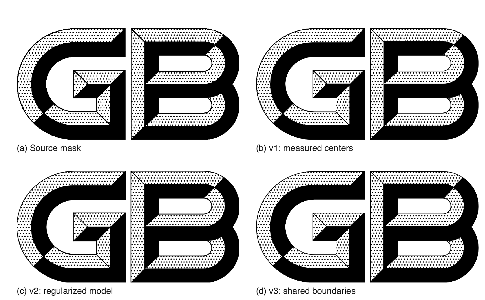
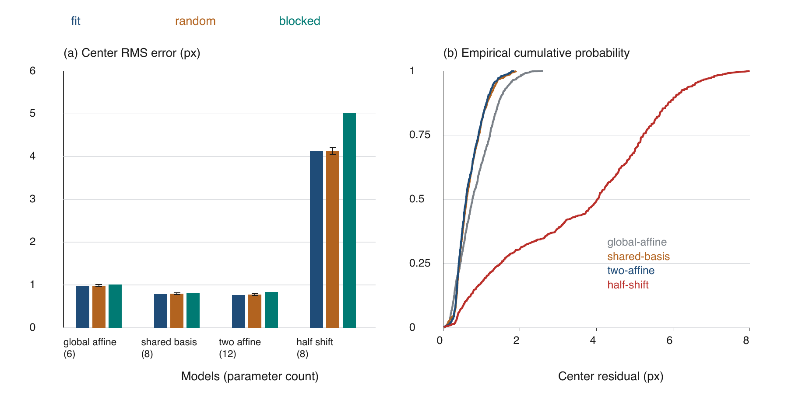
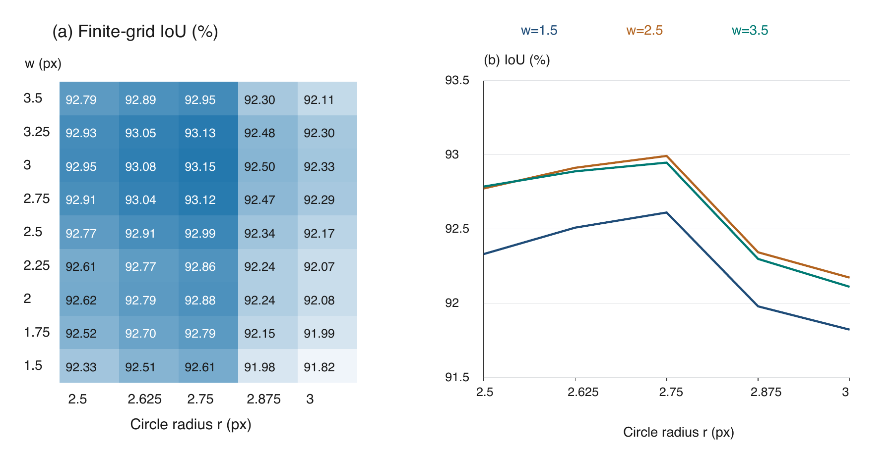
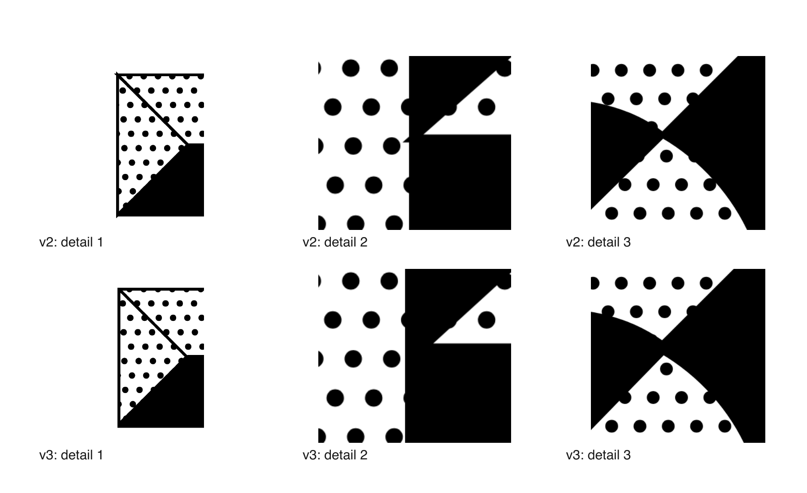
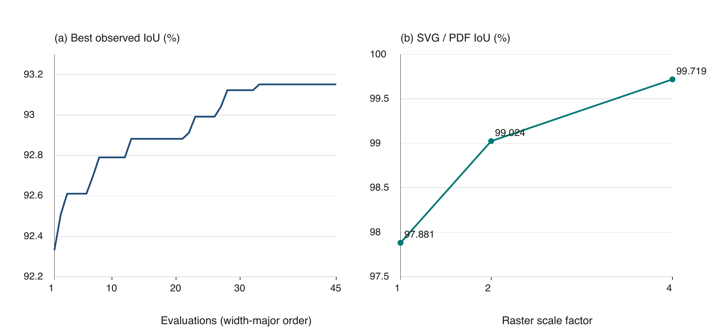
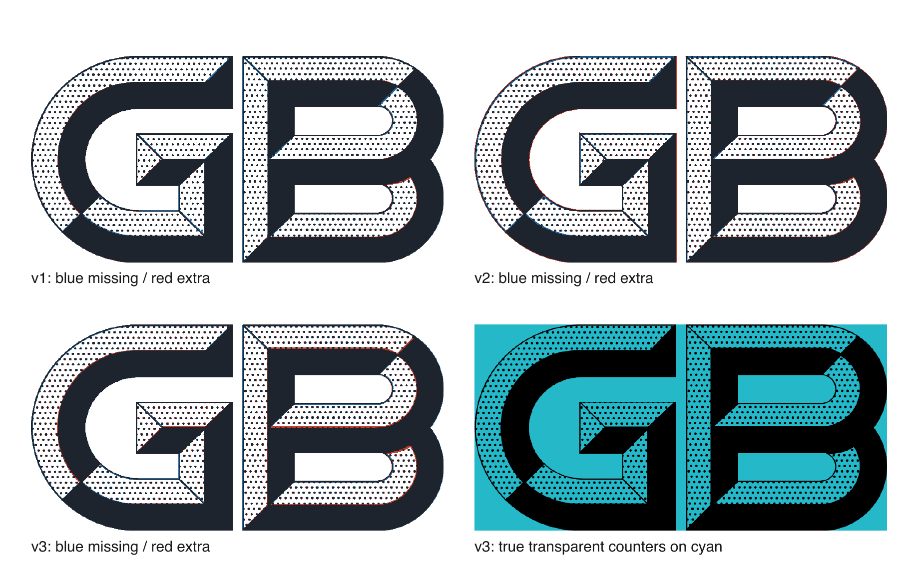

## 引言

标准文件封面的文件代号具有尺寸稳定、重复使用和印刷输出的特点。以GB标志为例，黑色实体、错列点阵和斜接缝共同形成具有立体感的字形。把封面中的位图直接放大，会同时放大像素量化和边界阶梯；仅描摹外轮廓，又不能表达点阵规律、交点连接以及透明孔洞。对于需要跨浏览器预览和PDF导出的排版软件，可重复生成、可解释修改和可测量验收同样重要。

从位图到矢量的经典路线，是提取轮廓并以曲线逼近观测边界。Potrace采用多边形分析和曲线平滑等步骤，将二值图像转为紧凑轮廓[^selinger2003]；Schneider给出了数字化点序列的分段三次贝塞尔拟合方法[^schneider1990]。这些方法说明了曲线描述的有效性，但不能单独回答一个特定标志中“哪些边应共用、哪些点应落在同一网格上”等结构问题。

本文研究一个受限而实际的逆向建模问题：以固定样本为观测，在不改变总体构形的前提下，把GB标志分解成少量可组合的函数和明确的拓扑约束。目标是获得可审计的生成模型，而非推断官方原生设计文件，也不以“看起来更规整”代替误差评估。GB/T 1.1—2020附录E给出封面布置和标志尺寸的规范背景[^gb2020]；本文采用40 mm×20 mm作为输出画布，字形拟合仍以实际样本为依据。

本文的工作包括：建立从逐点重建到仿射网格、再到共享边修复的版本证据链；给出实体、斜面、圆点、内孔及边界带的统一集合表达；以真实重渲染实验比较像素误差、参数敏感性和跨格式一致性，并明确近同源样本、条件留出和有限搜索的适用边界。本文不将经典几何公式作为新算法贡献，重点在结构分解、约束落实和证据完整性。

## 相关工作

### 曲线拟合与结构保持

分段贝塞尔拟合适合把长轮廓压缩成端点及控制点，同时保留局部可编辑性[^schneider1990]。然而，分别拟合相邻曲面边界，可能产生轻微错位；即使两个轮廓单独看都平滑，交会处也可能出现细缝或尖刺。Bessmeltsev和Solomon的研究将线条交点的连接歧义作为矢量化的重要问题[^bessmeltsev2019]。本文不实现其多向量场算法，而在已知标志语义下，显式建立共享边图，并以唯一曲线作为相邻区域的共同边界。

### 栅格监督与可微矢量图形

可微矢量光栅化把图像误差与矢量参数连接起来，可用于图形编辑和学习[^li2020]；DeepSVG通过分层表示学习矢量命令和形状结构[^carlier2020]。这类工作为后续联合优化提供了方向。本文采用确定性几何构造和有限参数扫描，不训练神经网络，也未运行上述方法的数值对照，因此不主张优于通用学习式矢量化方法。

### 输出语义与误差度量

SVG中的填充、描边、端帽和连接方式具有独立语义[^svgpainting]。把每条面边界都用相同居中描边画一遍，不保证最终可见宽度相同；重复描边、裁切和透明合成还会改变边缘像素。本文把“生成几何是否满足约束”和“某个渲染结果是否贴合观测”分开考察。边缘距离可与交并比互补，距离变换可用于高效实现最近边界距离[^felzenszwalb2012]；本文所用具体指标和实现范围在实验设置中单独定义。

## 数据、问题定义与版本基线

### 观测来源与独立性

研究资料来自归档目录中的4份2026年标准封面：GB/T 48316、GB/T 48300、GB 48319和GB/Z 295.2。最后一份仅用于检查嵌入图像资源的一致性，不扩展GB/Z封面排版研究。每份源PDF首页均包含948×474像素、每像素1位的图像蒙版。实验直接解码该对象，避免截图缩放、阅读器插值以及显示器比例引入额外误差。

主拟合样本为GB/T 48316—2026。其余3份作为近同源资源复核样本，不能当作3份独立设计原稿，也不能用“四份均通过”夸大统计证据。源文件、解码流及可见黑色掩膜分别计算SHA-256；本轮实验不覆盖或改写2026年10月28日的历史快照。

### 坐标与研究对象

令画布为$\Omega=[0,948]\times[0,474]$，左上为原点，横轴向右、纵轴向下。物理坐标映射为：

$$
T(x,y)=\left(\frac{40x}{948},\frac{20y}{474}\right)\ \mathrm{mm}.
\label{eq:physical}
$$

两轴比例均为$40/948$ mm，因而映射保持长宽比。一个模型单位对应约0.04219 mm。后续参数中的小数位用于确定性生成，不表示位图观测具有相同的小数精度。

研究对象分为实体轮廓$S$、点阵斜面并集$F$和两个内孔并集$H$。点阵只在$F$内可见；$S\setminus F$为黑色实体。G与B之间的间隙和B的两个内孔应保留背景透明性，而不是用白色图形覆盖。这一划分把字形结构与显示背景解耦。

### 三个历史阶段

表：历史版本及比较边界 {#tab:versions}

| 版⁠本 | 主要表示 | 所解决的问题 | 尚存限制 |
| --- | --- | --- | --- |
| v1 | 贝塞尔轮廓、1067个显式同径圆心 | 高保真重现样本的局部点位 | 点位参数多；采用白色覆盖区域 |
| v2 | 每字母一套仿射网格、统一细线 | 函数化点阵、真透明内孔 | 居中描边与独立边界引出交点问题 |
| v3 | 49条唯一边、41节点、边界子段复用 | 共享边、尖刺和局部细缝治理 | 仍有样本贴合差距；非官方方程 |

版本比较同时包含点阵、边界和合成方式的变化，不能用来单独归因某一因素。因此，本文把历史比较与在同一v3几何上的受控消融分开报告。

## 函数化几何模型

### 原语、轮廓与参数

表：当前v3的关键参数（单位为模型坐标，另注明者除外） {#tab:parameters}

| 参数 | G | B |
| --- | --- | --- |
| 网格原点$o$ | $(-3.379986,17.795963)$ | $(-5.037362,16.470264)$ |
| 行向量$u$ | $(12.188498,-0.000954)$ | $(12.167398,0.000521)$ |
| 跨行向量$v$ | $(6.457401,12.335678)$ | $(6.469773,12.335259)$ |
| 圆半径$r$ | 2.75 | 2.75 |
| 可见细线控制量$w$ | 2.50 | 2.50 |
| 物理圆直径 | 0.23207 mm | 0.23207 mm |

边界采用线段与三次贝塞尔曲线。给定端点$A,B$，线段为：

$$
L(A,B;t)=(1-t)A+tB,\quad t\in[0,1].
\label{eq:line}
$$

给定控制点$P_0,\ldots,P_3$，三次贝塞尔曲线为：

$$
C(t)=(1-t)^3P_0+3(1-t)^2tP_1+3(1-t)t^2P_2+t^3P_3.
\label{eq:bezier}
$$

模型包含2条实体闭合路径、9条斜面闭合路径和2条内孔闭合路径。控制点取自已有拟合模型；本轮论文实验不重新设计字形轮廓。完整系数随附机器可读模型和生成方程文档给出，正文只列对结构解释最重要的参数。

历史初始化先从蒙版边界拟合轴对齐椭圆弧$E(\phi)=(c_x+a\cos\phi,c_y+b\sin\phi)$，每段角跨度不超过$\pi/2$，再按切向控制点转换为三次近似。设弧端角为$\phi_0,\phi_1$，有：

$$
\begin{aligned}
k&=\frac43\tan\frac{\phi_1-\phi_0}{4},\quad
P_0=E(\phi_0),\quad P_3=E(\phi_1),\\
P_1&=P_0+kE'(\phi_0),\qquad P_2=P_3-kE'(\phi_1).
\end{aligned}
\label{eq:arc-init}
$$

这是初始曲线的近似构造；后续局部校准及子段复用后，以保存的贝塞尔控制点为准，不假定所有弧段仍是严格椭圆。初始点位则由842个完整圆心加225个边缘候选组成；边缘候选采用圆模板匹配，最低IoU为0.65、至少6个可见前景像素，中心间距至少8单位。共1067个圆统一半径，之后才研究其网格化表示。上述阈值是历史建模选择，不是标准规定。

### 仿射点阵与规则假设

圆心由整数索引生成：

$$
c_{ij}=o+i\,u+j\,v,\quad i,j\in\mathbb Z.
\label{eq:lattice}
$$

其中$u$连接同一行的相邻点，$v$连接相邻行的同索引点。对应的圆周和填充圆盘为：

$$
Q_{ij}(\theta)=c_{ij}+r(\cos\theta,\sin\theta),\qquad
D_{ij}=\{p:\|p-c_{ij}\|_2\le r\}.
\label{eq:disks}
$$

严格水平半距网格要求$u=(p,0)$、$v=(p/2,h)$。这是一种可检验的简化假设，不应由肉眼观察直接认定成立。对实测完整圆点，G、B的$v_x/u_x$约为0.5298和0.5317；允许轻微剪切的仿射形式可保留这一观测差异。

“错半点距”“45°斜向排列”和“等边三角格”是不同约束。若半距网格还要求等边三角形，则必须满足$h=\sqrt3p/2$；本样本行高约与行距相当，不能据此认定为等边三角格。向量$u+2v$与$-3u+2v$产生的次级方向接近44.5°和133.7°，而相邻行方向$v$约为62°；混淆这些方向会得到错误的函数解释。

点阵模型用每个字母6个连续标量描述原点与两个基向量，共12个标量；v1则记录1067个圆心，即2134个坐标标量。此比较只针对圆心表示，不包括轮廓、索引范围、半径、裁切域或序列化开销，不能据此宣称整个图形被压缩了相同比例。

### 轮廓复用与精确交点

共享边不能通过“再拟合一条看起来相同的曲线”获得。对于直线约束$n\cdot p=b$和基准曲线$C(t)$，交点由下式确定：

$$
f(t)=n\cdot C(t)-b=0,\quad t\in[0,1].
\label{eq:root}
$$

当前模型在选定单调曲线段上使用60次二分，G的两条约束为$x+y=477$，B顶部约束为$x+y=910$。取得根参数后，使用de Casteljau细分复用同一曲线子段，使轮廓和斜面使用相同的几何来源。求根迭代次数控制数值求解，不等于源图精度提高到浮点精度。

v3还把G下部斜面的旧2单位偏移移回实体轮廓，约相当于0.0844 mm；B外侧中部约0.09673单位的短回折边合并为共同凹口节点。二者均属于使既定结构自洽的修正，不是依据新的官方矢量图重新测量。

### 共享边、可见宽度与交点补片

令$\mathcal G=(V,E)$为斜面边界图。端点重合的边先分割，再按无向控制点序列去重；相邻斜面引用同一条边。当前共有49条唯一边、41个节点，其中3条边由两个斜面共同拥有。

统一的控制量$w$不等于每条SVG路径都设置相同的`stroke-width`。共享接缝采用居中宽度$w$；仅属于一个斜面的边采用居中宽度$2w$，经区域裁切或与黑色实体合并后控制可见单侧带。非交会处按边的所有权设置：

$$
a_e=\begin{cases}w,&\text{共享边},\\2w,&\text{单侧边},\end{cases}
\qquad h_e=a_e/2.
\label{eq:width}
$$

这里$a_e$为路径描边宽度，$h_e$为半宽。对图节点$q$，取各关联边的单位法向$n_e$，补片为：

$$
J_q=\operatorname{conv}\{q+h_en_e,\ q-h_en_e:e\sim q\}.
\label{eq:junction}
$$

补片是这些偏移点的凸包，因此所有顶点与节点的距离不超过$w$，不会形成无限延长的尖角连接。曲线法向由端部控制点差确定；退化切线明确报错。该构造约束局部外伸范围，而不是证明整图的拓扑与官方设计完全一致。

### 黑色墨迹的统一函数

令$B_e$为平端帽边界带，$D=\bigcup_{i,j}D_{ij}$为所有候选圆盘的并集，则最终黑色区域可写为：

$$
I(\Theta)=\Omega\cap\left\{S\cap\left[(S\setminus F)\cup(F\cap D)
\cup\bigcup_{e\in E}B_e\cup\bigcup_{q\in V}J_q\right]\right\}\setminus H.
\label{eq:ink}
$$

式\eqref{eq:line}至式\eqref{eq:ink}与参数模型共同构成可执行的函数系统。所有墨迹统一限制在实体内，并排除内孔；图层只包含黑色，其他区域透明。沿边界裁切出的半圆点可能是集合交运算的合法结果，不应一概作为毛刺删除；真正需要处理的是不受几何约束的外伸、重复边和交点断裂。

### 生成与校准流程

生成流程分为五步：读取固定轮廓与网格参数；构建整数索引并生成圆盘；求解曲线与约束直线交点并复用子段；构建唯一边、边界带及有界补片；按式\eqref{eq:ink}裁切后分别导出SVG和PDF。两个输出后端读取同一个模型，但光栅化过程独立，因此仍需跨渲染验证。

对待校准参数$\Theta$，可以建立像素、圆心和边界误差的组合目标：

$$
\mathcal L(\Theta)=\lambda_I[1-\operatorname{IoU}(R(\Theta),Y)]
+\lambda_c E_c(\Theta)+\lambda_b E_b(\Theta),\quad\Theta\in\mathcal C.
\label{eq:objective}
$$

其中$R$为指定渲染器，$Y$为源蒙版，$\mathcal C$包含共享边、非退化网格、正半径和孔洞透明等约束。式\eqref{eq:objective}给出后续联合优化框架；本文实际运行的是固定几何和网格下对$w,r$的离散IoU扫描，并未求解全部控制点的联合连续优化问题。

## 实验与结果分析

### 实验设置与评价指标

本轮实验使用Python 3.12.14、NumPy 2.3.5和Chrome 156.0.8078.48。SVG由同一Chrome会话捕获，固定画布948×474，不进行事后配准、平移或缩放择优。PDF由读取同一模型的ReportLab后端生成，再用Poppler独立光栅化。基准二值化阈值为128，即灰度小于128视为黑色；背景固定为白色，透明性另在青色背景检查。

令预测黑色集合为$A$、源蒙版为$Y$。交并比越大越好，异或像素数越小越好；覆盖率差保留符号，正值表示黑色增加：

$$
\operatorname{IoU}(A,Y)=\frac{|A\cap Y|}{|A\cup Y|},\quad
N_{\triangle}=|A\triangle Y|,\quad
\Delta_{\mathrm{cov}}=100\frac{|A|-|Y|}{948\times474}.
\label{eq:metrics}
$$

覆盖率差的单位为百分点，不是黑色区域的相对百分比。圆心误差采用二维欧氏残差的均方根（RMS）。条件留出实验使用固定随机种子20261029，重复30次约三分之一留出，并另把点集按纵坐标划成4个分位带，逐带留出。标准差仅描述这30次随机划分的波动，不作为独立样本上的置信区间。

### 样本近同源性与历史版本比较

4份源PDF包含3种不同的解码蒙版流；任意两份可见掩膜的异或差仅为0、2或4个像素，主样本黑色像素数为211252。因此，后续表格以主样本报告主要误差，其他来源的逐项结果放入数据文件，不把近似重复资源当作扩大样本量的手段。

表：固定画布下的历史版本重测 {#tab:version-results}

| 版本 | IoU / % ↑ | 异或像素 ↓ | 覆盖率差 / 百分点 |
| --- | ---: | ---: | ---: |
| v1 | 97.2557 | 5852 | −0.4153 |
| v2 | 92.5209 | 16437 | +0.1346 |
| v3 | 92.9916 | 15419 | +0.4658 |

图\ref{fig:versions}和表\ref{tab:version-results}表明，v1的观测贴合度最高。v3相对v2提高0.4707个百分点，但仍低于v1约4.2641个百分点。规则化版本整体表现为圆心参数减少而像素一致性降低；单独的网格贡献仍须通过受控对照辨别。v3在共享边和裁切方面的改进不能抵消历史版本的总体贴合损失，因而不能宣称函数化版本在所有评价维度上优于逐点重建。

### 点阵假设、复杂度与条件留出

从主样本提取842个完整圆点，其中G为386个、B为456个。提取规则使用四连通分量，面积14至40像素，包围盒边长4至8像素；裁切圆点、与实体粘连的圆点不参与拟合。比较4种坐标模型：全局仿射网格；共享基向量、独立原点；两字独立仿射网格；两字各自的严格水平半距网格。

全局仿射为6参数，共享基向量为8参数，两套独立仿射为12参数，两个严格半距网格合计8参数。它们均使用同一次全局推断的整数行列标签；参数数目不包括这些离散标签。特别地，严格半距比较允许重新最小二乘拟合原点、间距和行高，与后文“保相位替换”的图像消融不是同一实验。

<!-- pagebreak -->

表：网格模型残差及条件留出结果（单位：像素，越小越好） {#tab:grid}

| 模型 | 标量数 | 拟合RMS | 随机留出RMS | 分带留出RMS |
| --- | ---: | ---: | ---: | ---: |
| 全局仿射 | 6 | 0.9818 | 0.9839 ± 0.0227 | 1.0161 |
| 共享基向量 | 8 | 0.7858 | 0.7953 ± 0.0196 | 0.8070 |
| 独立仿射 | 12 | 0.7671 | 0.7768 ± 0.0181 | 0.8352 |
| 严格半距 | 8 | 4.1222 | 4.1346 ± 0.0791 | 5.0192 |

表\ref{tab:grid}与图\ref{fig:grid}不支持把严格0.5半距直接作为本样本的最佳解释。独立仿射训练误差最低，但共享基向量模型在横向分带留出中略优，提示用较少参数保留两字的共同周期可能更稳健。由于标签估计使用了全体数据，这一观察只涉及已给定格点对应关系下的坐标回归，不能写成对未知图像的独立泛化验证。

### 线宽与点径的参数扫描

固定v3轮廓、网格和共享关系，对线宽控制量$w\in\{1.50,1.75,\ldots,3.50\}$及圆半径$r\in\{2.500,2.625,\ldots,3.000\}$扫描，共45组。按线宽、再按半径的固定顺序评价，并记录截至当前评价次数的累计最佳值。该曲线是有限网格遍历的进度，不是梯度训练曲线，也不代表学习过程收敛。

表：默认参数与本轮有限扫描最优参数 {#tab:sweep}

| 参数设置 | $w$ | $r$ | IoU / % ↑ | 覆盖率差 / 百分点 |
| --- | ---: | ---: | ---: | ---: |
| 当前v3 | 2.50 | 2.75 | 92.9916 | +0.4658 |
| 网格内最佳 | 3.00 | 2.75 | 93.1516 | +1.0522 |

图\ref{fig:sweep}显示，半径变化会造成明显的得分变化；线宽变化与离散像素覆盖共同产生非光滑响应。本轮最优点使IoU提高0.1600个百分点、异或像素由15419降为15148，但黑色覆盖率偏差增大。因而“最佳”仅表示该离散集合中单一IoU指标最大；没有据此替换生产Logo，也不将其表述为视觉效果或物理印刷质量的全面提升。

历史v2另保存过15组较粗扫描，最佳$w=2.5,r=2.75$。其中$w=2,r=2.75$仅低约0.00085个百分点，说明粗扫描中的最佳线宽并不具有充分的唯一性证据。历史扫描与本轮v3扫描采用不同边界构造，应分开保存和解释。

### 受控消融与交会处分析

在v3模型上设置两个对照：只移除显式交点补片；只把每字母的网格基向量改为严格水平半距形式，并保留原点相位、纵向行高及其他几何。后一对照用于检查现有输出对强制网格假设的敏感性，不是经过重新优化的最优严格半距模型。

<!-- pagebreak -->

表：v3固定其余参数的受控消融 {#tab:ablation}

| 配置 | IoU / % ↑ | 异或像素 ↓ | 覆盖率差 / 百分点 |
| --- | ---: | ---: | ---: |
| 完整v3 | 92.9916 | 15419 | +0.4658 |
| 去交点补片 | 92.9911 | 15420 | +0.4651 |
| 保相位强制半距 | 86.0799 | 31756 | +0.4455 |

表\ref{tab:ablation}中，去补片后的源图异或误差只净增加1个像素，而两幅生成图直接比较改变了3个原生像素，在4倍渲染下改变35个设备像素。这不能说明交点补片无用；全局指标会把小区域差异稀释。图\ref{fig:junctions}给出局部检查入口，补片的作用首先是限定连接区域并防止尖角外伸，而不是大幅提高整图得分。

与保相位半距对照相比，当前仿射网格具有更高的像素一致性；但相位没有重估，不能把6.91个百分点的差值全部归因于“半距假设本身”。更公平的坐标层面比较应使用表\ref{tab:grid}中已重新拟合的严格半距模型。

### 多尺度、透明性与导出一致性

对同一v3模型分别在1、2、4倍分辨率下比较Chrome生成的SVG光栅与Poppler生成的PDF光栅。两边保持相同输出尺寸和阈值，不分别对源图再配准。

<!-- pagebreak -->

表：同模型SVG/PDF跨渲染一致性 {#tab:parity}

| 尺度 | 光栅尺寸 / 像素 | SVG/PDF IoU / % ↑ |
| --- | --- | ---: |
| 1倍 | 948×474 | 97.8807 |
| 2倍 | 1896×948 | 99.0243 |
| 4倍 | 3792×1896 | 99.7188 |

表\ref{tab:parity}表明，两条输出路径的差异随分辨率提高而减弱，仍非逐像素完全相同。PDF页面实测约40.0000 mm×20.0000 mm，包含3047个曲线对象，不包含嵌入位图或文字对象。青色背景下检查B的两个内孔及G/B间隙，3个探针均返回背景RGB $(36,184,200)$，验证这些位置具有真实透明性；有限探针不代替对任意未来参数的全域透明性证明。

已有全图拓扑记录对41个节点分类：30个非空内部采样核心未发现白像素，其余11个属于边界节点，不将其冒称内部采样通过。本轮另重测4倍轮廓裁切：206个阈值差异像素均在1个设备像素护带内，护带外黑像素为0；将孔洞掩膜内缩1个设备像素后，其内部黑像素为0。历史节点采样和本轮轮廓检验属于不同检查，均只针对当前固定模型。

### 二值阈值敏感性

利用相同的原生分辨率灰度截图，分别以96、128和160为阈值，源1位蒙版保持不变。该实验只改变评价阶段的二值化规则，不改变矢量几何，也不模拟真实打印设备的墨色扩散。

<!-- pagebreak -->

表：阈值变化下的源图IoU（单位：%，越大越好） {#tab:threshold}

| 版本 | 阈值96 | 阈值128 | 阈值160 |
| --- | ---: | ---: | ---: |
| v1 | 96.5358 | 97.2557 | 96.3131 |
| v2 | 92.4000 | 92.5209 | 92.2547 |
| v3 | 92.7263 | 92.9916 | 92.7641 |

表\ref{tab:threshold}的版本排序保持不变，但绝对分数存在波动。因此，主结果必须随阈值和渲染器版本一起报告；不能将某一阈值的小幅优势解释为与设备无关的几何精度。

### 差分分布与失败模式

图\ref{fig:difference}说明，误差既分布于点阵，也出现在曲线与斜面边界。用规则网格替代局部点位后，局部相位误差会沿多行累积；提高线宽可减少某些漏墨，却同时增加另一些区域的多墨。因此，仅扩大黑色区域不能稳定逼近真实结构，单一覆盖率或整体得分不足以决定局部修复是否合理。

本文保留三类失败模式：强制半距且不重估相位导致明显退化；单一IoU最优点加重覆盖率偏差；局部交点变化在全局得分中几乎不可见。这些结果为后续多目标、结构保持的优化提供依据，而非只展示最优候选。

## 讨论与未来工作

### 样本贴合、规则性与设计意图

同径圆、共享边与统一线宽是本研究明确选择的规范化约束。源图中的点位剪切、线宽变化可能来自原设计、扫描、排版变换或二值量化，现有资料不足以唯一分辨。v1更贴近观测，v3更便于结构化生成；两者代表不同目标，不应仅用单一IoU给出绝对优劣，也不能把工程约束追认为官方设计原意。

本研究的圆点与曲线采用矢量原语，放大时不会增加几何采样点；然而屏幕和打印设备仍需光栅化，小尺度上的点形、边缘浓度和断续仍受设备分辨率影响。跨格式IoU高说明两条实现路径较一致，不说明它们与官方设计真值相同。几何单位换算精确，也不自动保证用户打印时采用100%比例。

### 可识别性与实验局限

首先，独立设计来源只有有限的一个观测族。多个封面中的相近蒙版不能替代跨设计验证。其次，完整圆点提取排除了裁切点与粘连点，圆心残差只能代表这一子集。再次，网格行列编号由全体点推断，留出实验是条件于这些标签的参数检验，不是完整检测和索引流程的无泄漏预测验证。

固定阈值IoU对抗锯齿和相位敏感。本文保留原始分辨率、渲染器版本和阈值设置，另做敏感性测试；但没有开展人眼偏好评价、实体打印测量或正式规范认证，也没有把Potrace、PolyVector Fields、DiffVG和DeepSVG纳入实际运行的基线。有关方法在本文中承担背景和研究方向的作用。

最后，局部补片有界只排除了无界尖角，并不证明任何参数下都没有微小白缝。若后续改动控制点、点阵相位或共享关系，仍需重跑全图交点与透明性检查。参数扫描的最佳点仅对给定范围、步长、渲染器及阈值有效，近似最优不代表统计上唯一，更不是全局最优证明。

### 后续改进路线

第一，增加真正独立的高质量资料，优先核对官方原生矢量资源或更高分辨率印刷图，建立各来源的几何变换和测量不确定度。第二，先在训练子集估计周期和整数索引，再给留出点分配最近格点；比较周期标签歧义和缺失点对结果的影响，避免条件留出被误解为完整泛化。

第三，在保留共享关系的前提下联合优化曲线控制点、网格相位、线宽与点径，采用软掩膜或可微光栅化获得更连续的误差面[^li2020]。同时用边缘距离与结构约束限制“牺牲拓扑换像素得分”的解；可借助距离变换降低边界误差的计算开销[^felzenszwalb2012]。第四，建立几何尺寸与光学补偿的双层模型：几何层维持相同原语，光学层只针对明确的输出分辨率调整点径或描边，并记录补偿版本，不能悄然改写基线。

第五，将函数系统接入版面校准账本：固定资源、位置约束、单位换算和最终墨迹测量分别记录。标志生成器只负责局部坐标内的图形，封面排版器负责其物理尺寸与定位，验收器比较实际PDF墨迹。这种职责划分可推广到其他固定字样和版面资源，但仍需针对不同对象重新建立证据。

## 结论

本文以GB标志为案例，给出从位图观测、版本保留到函数化生成和误差评估的可复现工作流。线段、三次贝塞尔、仿射网格和集合运算足以表达当前重建模型；共享曲线、唯一边图和有界补片为交会处提供了明确的几何约束。实验证据同时保留规则化带来的参数减少及其像素贴合损失，避免把工程一致性等同于恢复官方原始方程。

所得模型适用于受控资源的程序化生成和排版集成。对于原始设计真值、独立样本泛化与实体印刷效果，现有证据仍有限；后续应在独立来源、联合参数优化和设备级测量上推进，而不是仅继续提高某一张位图的分数。

## 数据、代码与AI辅助说明

本文配套材料保存在`research/gb-logo-paper/`，包含实验程序、逐项数据、图表和输入哈希。历史研究快照保存在`md2pdf-research/gb/logo-function-study/`，作为只读来源。源封面不随本论文重复分发，复现时需提供相同文件并核对哈希。完整轮廓与点阵系数由项目中的JSON模型和方程文档提供；生成器、实验版本及命令见配套说明。

Jiye Qian为通讯作者。GPT-6.1 Sol署名标识AI辅助工作，涉及材料整理、数学表达、程序与文稿生成；研究判断与投稿责任由人类作者最终核验。作者单位列示不表示机构背书；正式投稿时，作者资格及AI披露方式须遵循目标刊物政策。

[^selinger2003]: SELINGER P. Potrace: a polygon-based tracing algorithm[R/OL]. 2003[2026-10-29]. [技术报告原文](https://potrace.sourceforge.net/potrace.pdf).

[^schneider1990]: SCHNEIDER P J. An Algorithm for Automatically Fitting Digitized Curves[M]//GLASSNER A S, ed. Graphics Gems. Academic Press, 1990: 612-626. [作者章节原文](https://lhf.impa.br/cursos/tmg/Schneider-1990.pdf).

[^gb2020]: 国家市场监督管理总局, 国家标准化管理委员会. GB/T 1.1—2020 标准化工作导则 第1部分：标准化文件的结构和起草规则[S]. 中国标准出版社, 2020.

[^bessmeltsev2019]: @article{bessmeltsev2019,
  author = {Bessmeltsev, Mikhail and Solomon, Justin},
  title = {Vectorization of Line Drawings via PolyVector Fields},
  journal = {ACM Transactions on Graphics},
  year = {2019},
  doi = {10.1145/3202661},
  url = {https://dspace.mit.edu/entities/publication/65581613-d48e-42be-b71d-6dcecb16eccf}
  }

[^li2020]: @article{li2020,
  author = {Li, Tzu-Mao and Lukac, Michal and Gharbi, Michael and Ragan-Kelley, Jonathan},
  title = {Differentiable Vector Graphics Rasterization for Editing and Learning},
  journal = {ACM Transactions on Graphics},
  year = {2020},
  volume = {39},
  number = {6},
  pages = {193:1--193:15},
  doi = {10.1145/3414685.3417871},
  url = {https://people.csail.mit.edu/tzumao/diffvg/}
  }

[^carlier2020]: @inproceedings{carlier2020,
  author = {Carlier, Alexandre and Danelljan, Martin and Alahi, Alexandre and Timofte, Radu},
  title = {DeepSVG: A Hierarchical Generative Network for Vector Graphics Animation},
  booktitle = {Advances in Neural Information Processing Systems},
  volume = {33},
  year = {2020},
  url = {https://papers.neurips.cc/paper_files/paper/2020/hash/bcf9d6bd14a2095866ce8c950b702341-Abstract.html}
  }

[^svgpainting]: WORLD WIDE WEB CONSORTIUM. Scalable Vector Graphics (SVG) 2: Painting, Filling, Stroking and Marker Symbols[EB/OL]. [2026-10-29]. [规范原文](https://www.w3.org/TR/SVG/painting.html).

[^felzenszwalb2012]: @article{felzenszwalb2012,
  author = {Felzenszwalb, Pedro F. and Huttenlocher, Daniel P.},
  title = {Distance Transforms of Sampled Functions},
  journal = {Theory of Computing},
  year = {2012},
  volume = {8},
  pages = {415--428},
  doi = {10.4086/toc.2012.v008a019},
  url = {https://theoryofcomputing.org/articles/v008a019/}
  }
